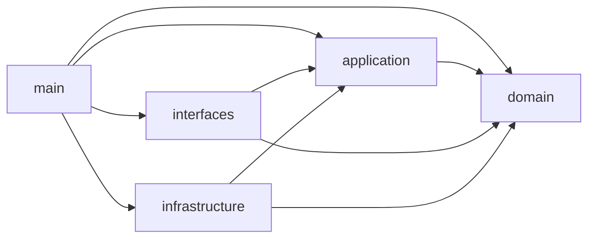

# Arquitectura

Backend hexagonal (puertos y adaptadores) en `backend/src`; frontend SPA con un único adaptador HTTP en `frontend/src/api/`. Detalle de decisiones en `docs/DECISIONS.md` y en el spine de arquitectura bajo `docs/bmad/planning-artifacts/architecture/`.

## Capas

| Capa | Directorio | Contenido | Puede importar |
|---|---|---|---|
| Dominio | `domain/` | entidades `User` y `Accident`, catálogos, máquina de estados (`AccidentStatus`), errores de dominio | nada |
| Aplicación | `application/` | casos de uso (`use-cases/auth`, `use-cases/accidents`), puertos, errores de aplicación | `domain/` |
| Infraestructura | `infrastructure/` | adaptadores `pg`, bcrypt, jsonwebtoken, pino, reloj, ids, config (`env.ts`) | `application/`, `domain/` |
| Interfaces | `interfaces/http/` | Express: rutas, controladores, middleware, esquemas Zod, presenters, `errorMapper` | `application/`, `domain/` |
| Composición | `main/` | `container.ts`, `server.ts`, `seedReviewer.ts` | todo |

Puertos (`application/ports`): `UserRepository`, `AccidentRepository`, `TokenRevocationRepository`, `PasswordHasher`, `TokenService`, `Clock`, `IdGenerator`, `Logger`. Adaptadores: `PgUserRepository`, `PgAccidentRepository`, `PgTokenRevocationRepository`, `BcryptPasswordHasher`, `JwtTokenService`, `SystemClock`, `CryptoIdGenerator`, `PinoLogger`. Las pruebas unitarias usan fakes de `backend/tests/fakes`; la integración usa PostgreSQL real.

## Reglas de dependencia

Se verifican con `npm run lint:arch` (`.dependency-cruiser.cjs` más `scripts/check-globals.mjs`): `domain` no importa nada; `application` solo `domain`; `interfaces` no importa `infrastructure` ni `main`; `infrastructure` no importa `interfaces` ni `main`; solo `main` es importado desde `main`; el código fuente no importa tests; sin ciclos ni imports irresolubles. `check-globals` prohíbe `new Date(`, `Date.now`, `crypto.`, `process.`, `Buffer.`, `console.` en `domain/` y `application/`, y `fetch(` fuera de `frontend/src/api/`. La capa HTTP recibe su configuración por inyección (`createHttpApp(deps)`); que no lea `process.env` es una convención, no una regla verificada por `lint:arch` (`check-globals` solo cubre `domain/` y `application/`).

Grafo de dependencias exportado: `docs/architecture/dependency-graph.mmd` (Mermaid). No se generó SVG porque `dot` (Graphviz) no está instalado en este entorno. Se regenera con:

```bash
npx depcruise backend/src --config .dependency-cruiser.cjs --output-type mermaid > docs/architecture/dependency-graph.mmd
# con Graphviz instalado:
npx depcruise backend/src --config .dependency-cruiser.cjs --output-type dot | dot -T svg > docs/architecture/dependency-graph.svg
```



## Orden de middleware y errores

Globales: `helmet` → `cors` (solo `FRONTEND_ORIGIN`, con credenciales) → `cookie-parser`. Luego `Cache-Control: no-store` en `/api`, routers de auth y accidentes, `404` de `/api`, estáticos con fallback SPA (si existe `frontend/dist`), un `404` final y el `errorMapper`, único traductor de errores a HTTP.

## Secuencia de autenticación

```mermaid
sequenceDiagram
  participant B as Navegador
  participant R as Express (interfaces/http)
  participant UC as Casos de uso
  participant DB as PostgreSQL
  B->>R: POST /api/auth/login {email,password}
  R->>UC: LoginUser (compare; hash ficticio si no existe)
  UC-->>R: {token, expiresAt}, user
  R-->>B: 200 user + Set-Cookie session (httpOnly, lax)
  B->>R: GET /api/accidents (cookie)
  R->>UC: AuthenticateRequest(token)
  UC->>DB: revoked_tokens por jti (error: 503)
  UC->>DB: users por id=sub (rol actual)
  UC-->>R: actor {userId, role}
  R->>UC: ListMyAccidents(actor)
  UC->>DB: accidents WHERE owner_id = actor.userId
  R-->>B: 200 [...]
```

## Vínculo cuenta-accidente

El middleware `authenticate` deja `{userId, role}` en `res.locals.auth`; los controladores lo pasan como `actor` y los casos de uso usan `ownerId = actor.userId`. El esquema del alta es estricto, así que el cliente no puede enviar propietario. Los casos de uso que reciben `:id` validan que sea UUID antes de consultar y responden el mismo `NotFoundError` para ajeno, inexistente o mal formado.

## Mismo origen y frontend

En producción Express sirve `/api/*` y `frontend/dist`. En desarrollo Vite (`:5173`) hace proxy de `/api` a `:3000`. El frontend usa rutas relativas `/api` y `credentials: 'include'`; un 401 limpia la sesión y navega a `/login` (excepto en `/auth/login` y `/auth/me`). `RequireAuth` mejora la UX, pero la autoridad es el servidor.
