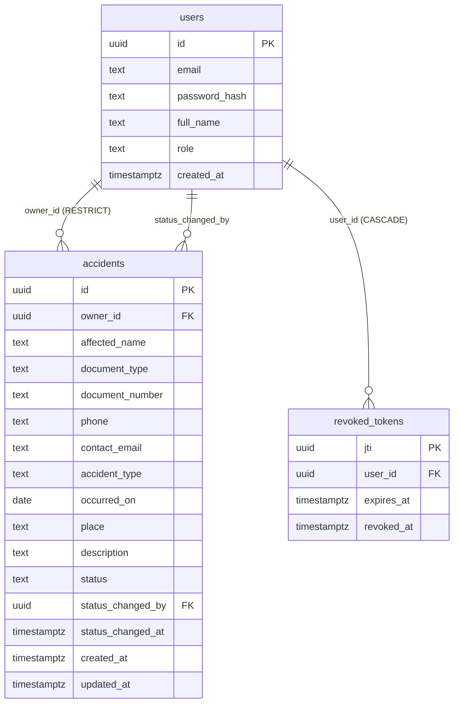

# Modelo de datos

Derivado de `backend/migrations/1763230000000_initial-schema.sql` (PostgreSQL 16, control de versiones en la tabla `pgmigrations` de node-pg-migrate). La aplicación no ejecuta DDL; una migración aplicada no se edita, se agrega otra.

## Diagrama ER

## Tablas y restricciones

### `users`

| Columna | Tipo | Restricciones |
|---|---|---|
| `id` | uuid | PK, `DEFAULT gen_random_uuid()` |
| `email` | text | NOT NULL, `CHECK (email = lower(email))` |
| `password_hash` | text | NOT NULL |
| `full_name` | text | NOT NULL, longitud 3 a 120 |
| `role` | text | NOT NULL, `DEFAULT 'USER'`, `IN ('USER','REVIEWER')` |
| `created_at` | timestamptz | NOT NULL, `DEFAULT now()` |

Índice único `users_email_lower_uq` sobre `lower(email)`.

### `accidents`

| Columna | Tipo | Restricciones |
|---|---|---|
| `id` | uuid | PK |
| `owner_id` | uuid | NOT NULL, FK `users(id)` `ON DELETE RESTRICT` |
| `affected_name` | text | NOT NULL, longitud 3 a 120 |
| `document_type` | text | NOT NULL, `IN ('CC','CE','TI','PASAPORTE')` |
| `document_number` | text | NOT NULL, `~ '^[A-Za-z0-9]{5,20}$'` |
| `phone` | text | NOT NULL, `~ '^\+?[0-9]{7,15}$'` |
| `contact_email` | text | NOT NULL, longitud <= 254 |
| `accident_type` | text | NOT NULL, `IN ('TRANSITO','LABORAL','DOMESTICO','DEPORTIVO','OTRO')` |
| `occurred_on` | date | NOT NULL, `>= DATE '1900-01-01'` |
| `place` | text | NOT NULL, longitud 3 a 200 |
| `description` | text | NOT NULL, longitud 20 a 2000 |
| `status` | text | NOT NULL, `DEFAULT 'REGISTRADO'`, constraint `accidents_status_check` `IN ('REGISTRADO','EN_REVISION','CERRADO')` |
| `status_changed_by` | uuid | NULL, FK `users(id)` |
| `status_changed_at` | timestamptz | NULL |
| `created_at`, `updated_at` | timestamptz | NOT NULL, `DEFAULT now()` |

Restricción de tabla: `(status_changed_by IS NULL) = (status_changed_at IS NULL)`. Índice `accidents_owner_occurred_idx` sobre `(owner_id, occurred_on DESC, created_at DESC)`. La aplicación escribe explícitamente `id`, `created_at` y `updated_at`; los `DEFAULT` son una red de seguridad.

### `revoked_tokens`

| Columna | Tipo | Restricciones |
|---|---|---|
| `jti` | uuid | PK |
| `user_id` | uuid | NOT NULL, FK `users(id)` `ON DELETE CASCADE` |
| `expires_at` | timestamptz | NOT NULL |
| `revoked_at` | timestamptz | NOT NULL, `DEFAULT now()` |

Índice `revoked_tokens_expires_idx` sobre `expires_at`. Las filas expiradas se purgan al arrancar y cada hora.

## Los mismos límites en tres niveles

Los límites de cada campo existen como esquema Zod (`interfaces/http/schemas`), invariante de dominio (`domain/`) y `CHECK` de BD, y el frontend los replica en `frontend/src/api/accidentSchema.ts`. Agregar un estado exige tocar el dominio, una migración que reemplace `accidents_status_check`, la etiqueta de la UI y las pruebas (DEC-013).
